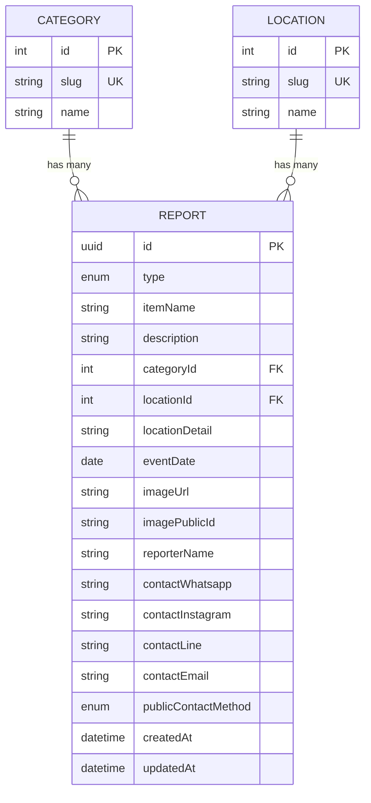

# Database Design — Pacil Lost & Found

Database: **PostgreSQL**. ORM: **Prisma** (implemented in Week 3 / Checkpoint 3).
This document is the plan; no Prisma code is required yet.

## 1. Entities and Relationships

- **Category** (1) —— (N) **Report**: one category has many reports.
- **Location** (1) —— (N) **Report**: one location has many reports.
- A **Report** belongs to exactly one Category and exactly one Location.



Why `Category` and `Location` are separate tables (not plain text)?
Filters and dropdowns need a fixed list; separate tables prevent typos like "Gedung Lama" vs "gedung a", and give us a real **relationship** to design and explain.

## 2. Enums

| Enum | Values |
|------|--------|
| `ReportType` | `LOST`, `FOUND` |
| `ContactMethod` | `WHATSAPP`, `INSTAGRAM`, `LINE`, `EMAIL` |

## 3. Report Fields

| Field | Prisma type | PostgreSQL type | Required | Validation / notes | Returned by API? |
|-------|-------------|-----------------|----------|--------------------|------------------|
| `id` | `String @id @default(uuid())` | `TEXT` (uuid string) | auto | | yes |
| `type` | `ReportType` | enum | yes | LOST / FOUND | yes |
| `itemName` | `String @db.VarChar(100)` | `VARCHAR(100)` | yes | 3–100 | yes |
| `description` | `String @db.VarChar(1000)` | `VARCHAR(1000)` | yes | 10–1000 | yes |
| `categoryId` | `Int` (FK) | `INTEGER` | yes | must exist | as `category {slug,name}` |
| `locationId` | `Int` (FK) | `INTEGER` | yes | must exist | as `location {slug,name}` |
| `locationDetail` | `String? @db.VarChar(100)` | `VARCHAR(100)` | no | e.g. "Ruang A206" | yes |
| `eventDate` | `DateTime @db.Date` | `DATE` | yes | not in the future | yes (`YYYY-MM-DD`) |
| `imageUrl` | `String?` | `TEXT` | no | Cloudinary `secure_url` | yes |
| `imagePublicId` | `String?` | `TEXT` | no | Cloudinary `public_id` (needed for cleanup/delete) | **no** |
| `reporterName` | `String @db.VarChar(60)` | `VARCHAR(60)` | yes | 2–60 | yes |
| `contactWhatsapp` | `String?` | `TEXT` | no* | phone format | **no** (only via `contact`) |
| `contactInstagram` | `String?` | `TEXT` | no* | stored without `@` | **no** (only via `contact`) |
| `contactLine` | `String?` | `TEXT` | no* | | **no** (only via `contact`) |
| `contactEmail` | `String?` | `TEXT` | no* | | **no** (only via `contact`) |
| `publicContactMethod` | `ContactMethod` | enum | yes | the matching contact field must be non-null | as `contact.method` |
| `createdAt` | `DateTime @default(now())` | `TIMESTAMP(3)` | auto | | yes |
| `updatedAt` | `DateTime @updatedAt` | `TIMESTAMP(3)` | auto | | yes |

\* Required only for the method selected in `publicContactMethod`.

## 4. Reference Data (seeded)

**Categories** — `card-document` Kartu & Dokumen, `electronics` Elektronik, `bags-wallets` Tas & Dompet, `drinkware` Tumbler & Botol, `keys` Kunci, `clothing` Pakaian & Aksesori, `stationery` Buku & Alat Tulis, `other` Lainnya.

**Locations** — `gedung-lama`, `gedung-baru`, `perpustakaan`, `kantin`, `sekretariat`, `pos-satpam`, `musholla`, `area-parkir`, `lainnya`.

Source of truth: `mock-data/meta.json`. Adjust the list together with the Frontend team if needed.

## 5. Draft Prisma Schema (for Week 3)

> Draft only. In Week 3, check the current Prisma docs for the installed version (setup/config details change between major versions) before applying it.

```prisma
enum ReportType {
  LOST
  FOUND
}

enum ContactMethod {
  WHATSAPP
  INSTAGRAM
  LINE
  EMAIL
}

model Category {
  id      Int      @id @default(autoincrement())
  slug    String   @unique
  name    String
  reports Report[]
}

model Location {
  id      Int      @id @default(autoincrement())
  slug    String   @unique
  name    String
  reports Report[]
}

model Report {
  id                  String        @id @default(uuid())
  type                ReportType
  itemName            String        @db.VarChar(100)
  description         String        @db.VarChar(1000)

  categoryId          Int
  category            Category      @relation(fields: [categoryId], references: [id])
  locationId          Int
  location            Location      @relation(fields: [locationId], references: [id])
  locationDetail      String?       @db.VarChar(100)

  eventDate           DateTime      @db.Date
  imageUrl            String?
  imagePublicId       String?

  reporterName        String        @db.VarChar(60)
  contactWhatsapp     String?
  contactInstagram    String?
  contactLine         String?
  contactEmail        String?
  publicContactMethod ContactMethod

  createdAt           DateTime      @default(now())
  updatedAt           DateTime      @updatedAt

  @@index([type])
  @@index([categoryId])
  @@index([locationId])
  @@index([createdAt])
}
```

## 6. Mapping: API -> Prisma

| API concept | Prisma implementation |
|-------------|-----------------------|
| `q` search | `where: { itemName: { contains: q, mode: 'insensitive' } }` |
| `type` filter | `where: { type }` |
| `category` filter (slug) | `where: { category: { slug } }` |
| `location` filter (slug) | `where: { location: { slug } }` |
| Pagination | `skip: (page - 1) * limit`, `take: limit`, plus `prisma.report.count({ where })` for `totalItems` |
| Sort | `orderBy: { createdAt: 'desc' }` (`newest`) or `'asc'` (`oldest`) |
| Include names | `include: { category: true, location: true }` |
| Create from slugs | Look up `Category` / `Location` by `slug`, then `create` with their ids |
| Not found | `findUnique({ where: { id } })` returns `null` -> 404 |

## 7. Contact Privacy (very important)

All responses must go through **one** mapper function, so private data can never leak by accident:

```js
function toPublicReport(report) {
  const contactByMethod = {
    WHATSAPP: report.contactWhatsapp,
    INSTAGRAM: report.contactInstagram,
    LINE: report.contactLine,
    EMAIL: report.contactEmail,
  };

  return {
    id: report.id,
    type: report.type,
    itemName: report.itemName,
    description: report.description,
    category: { slug: report.category.slug, name: report.category.name },
    location: { slug: report.location.slug, name: report.location.name },
    locationDetail: report.locationDetail,
    eventDate: report.eventDate.toISOString().slice(0, 10),
    imageUrl: report.imageUrl,
    reporterName: report.reporterName,
    contact: {
      method: report.publicContactMethod,
      value: contactByMethod[report.publicContactMethod],
    },
    createdAt: report.createdAt,
    updatedAt: report.updatedAt,
  };
}
```
Never `res.json(report)` directly from Prisma.

## 8. Week 3 Implementation Plan

1. Create a PostgreSQL database (local, or a hosted one for production).
2. Install Prisma and Prisma Client; set `DATABASE_URL` in `.env`.
3. Write `schema.prisma` from section 5.
4. Create and **commit** the first migration (`prisma/migrations/`).
5. Seed categories and locations (+ optionally `mock-data/reports.json`).
6. Replace the in-memory service from Checkpoint 2 with a Prisma-based service (keep the same function names so controllers don't change).
7. Apply migrations to the production database.
8. Test: create a report -> restart the backend -> the report is still there.
